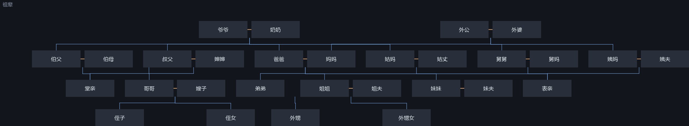

# 过年啦！（Happy New Year）

一个以**中国家族称谓**为消除规则的 8×8 三消游戏。经典三消的骨架（相邻交换、三连消除、连锁计分）保留不变，把"三个同色"换成"三人之间的亲缘关系成立"，在判定层做出差异。



## 玩法

- 8×8 盘面，47 位家庭成员、10 个家庭、35 种称谓，60 手一局
- 交换相邻两格后，除了要凑成三连，还要判定三人的亲缘关系是否合法：

| 规则 | 判定条件 | 合法组数 | 倍率 |
|---|---|---|---|
| R1 直系三代 | A 是 B 的父母、B 是 C 的父母（三人任意顺序） | 64 | ×5.0 |
| R2 同代姻亲 | 三人皆为姻亲且代际相同 | 11 | ×3.0 |
| R3 同类三消 | 同辈同类 + 称谓互异；平辈池需来自三家不同家庭 | 460 | ×1.0 |

- 连锁倍率 `1 + 0.25 × (k − 1)`，k ≥ 5 时封顶 ×2.0
- 盘面用反向构造生成：开局 0% 自带三连、至少 3 步可走；无解自动洗牌（实测每局 2.4~3.0 次）

## 技术栈

- 引擎：团结引擎 2022.3.62t14（与 Unity 2022.3 LTS API 兼容），Built-in 渲染管线
- UI：UGUI + TextMeshPro，CanvasScaler 基准 1920×1080
- 逻辑层：纯 C#，**不引用 UnityEngine**，可脱离编辑器用 `dotnet` 直接编译与测试
- 测试：Editor 脚本模拟真实点击链路（15 阶段）+ 运行链路逐帧断言 + 800 局数值仿真
- 字体：[Noto Sans SC](https://fonts.google.com/noto/specimen/Noto+Sans+SC)（SIL OFL 1.1）

## 目录结构

```
Assets/
├── Scripts/
│   ├── Core/          纯逻辑：族谱图、盘面模型、规则判定、计分、生成与死局检测
│   ├── Gameplay/      BoardController：一次交换的编排
│   ├── UI/            HUD、结算、暂停、规则说明、族谱面板
│   ├── Presentation/  交换/下落/消除的动画时间线
│   ├── Boot/          GameBootstrap 入口
│   └── Editor/        点击链路自检、构建脚本
├── Data/              族谱数据 FamilyTree.json（47 人）与数值资产
├── Art/Fonts/         Noto Sans SC 字体与 SDF 资源
└── Scenes/            主场景（由编辑器脚本生成，非手写 YAML）
Tools/
├── LogicTests/        逻辑层单元测试（dotnet）
├── UnityCompileCheck/ 脱离引擎的编译检查
└── Playtest/          批量试玩与数值统计
docs/screenshots/      README 用图
```

## 运行

1. 用 Unity 2022.3 LTS 或团结引擎 2022.3 打开本目录
2. 打开 `Assets/Scenes` 下的主场景，进入播放模式
3. 分辨率 1920×1080 最佳，4:3 与 16:9 均可自适应

> `Library/`、`Build/`、`Dist/`、`Logs/`、`UserSettings/` 是本地产物，已在 `.gitignore` 中排除，克隆后由编辑器重新生成。

## 测试

```bash
# 逻辑层单元测试
dotnet test Tools/LogicTests

# 脱离引擎的编译检查
dotnet build Tools/UnityCompileCheck

# 播放模式下的点击链路自检（命令行）
Unity.exe -batchmode -projectPath . -executeMethod Game.EditorTools.ClickProbe.RunFromCommandLine
```

## 数据与素材

- `Assets/Data/FamilyTree.json`：47 条家庭成员记录（称谓、辈分、父母、配偶），可直接替换扩展
- 自动生成的占位素材仅用于演示，正式发布前需人工精修
- 除 Noto Sans SC 外，仓库内代码与资源均为本项目自建


## 开发过程

想复刻一款结构类似的游戏（任何"离散符号 + 稳定关系"的题材都适用），看这份文档：

- [开发过程与复刻指南](docs/开发过程与复刻指南.md)：从选题定判定层、写纯逻辑、盘面生成与数值标定，到状态机、族谱面板三轮返工、15 阶段自动化自检的完整顺序，附检查清单与工作量参考。

## 上传到 GitHub

仓库已初始化并暂存全部文件（`.gitignore` 已排除构建产物、分发包与含个人信息的文档）。

- 最省事：双击根目录的 `push-to-github.bat`，按提示填三项（署名、邮箱、仓库地址）
- 手动：

```bash
git config user.name "你的名字"
git config user.email "你的GitHub noreply邮箱"
git commit -m "feat: 家族称谓三消 Demo"
git remote add origin https://github.com/<用户名>/<仓库名>.git
git push -u origin main
```

## License

- 本项目代码：MIT，见 [LICENSE](LICENSE)
- 字体 [Noto Sans SC](https://fonts.google.com/noto/specimen/Noto+Sans+SC)：SIL Open Font License 1.1，
  版权声明与许可证原文见 [Assets/Art/Fonts/NotoSansSC-OFL.txt](Assets/Art/Fonts/NotoSansSC-OFL.txt)
- Unity TextMesh Pro 自带的 Liberation Sans：同样为 SIL OFL 1.1，见 `Assets/TextMesh Pro/Fonts/LiberationSans - OFL.txt`
